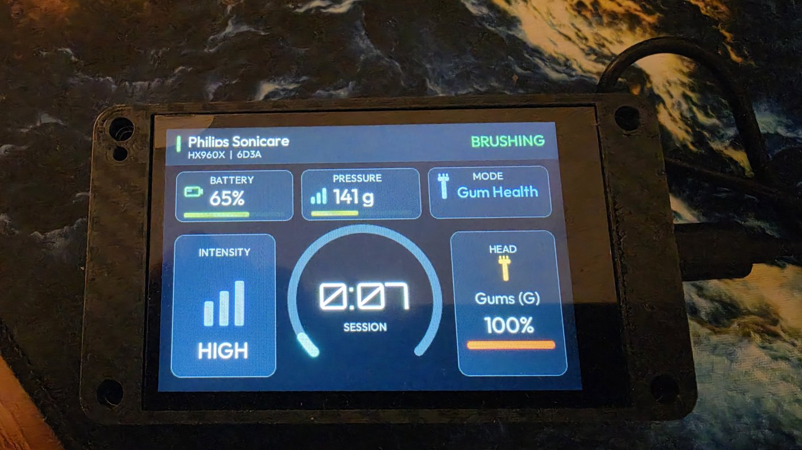

# ESP Bridge

Everything needed to turn an ESP32 into a Bluetooth bridge for the Philips
Sonicare integration. The ESP handles the BLE connection to the toothbrush
(including LE Secure Connections bonding for models that require it) and
exposes it to Home Assistant via ESPHome service calls and events.

Use this when Home Assistant itself has no Bluetooth adapter in range of
the toothbrush, when you want to monitor multiple brushes from one bridge,
or when you prefer a dedicated, always-connected bridge over the less
stable `bluetooth_proxy` path.

Side by side with the Direct BLE path (Home Assistant's own Bluetooth
adapter), which the integration uses when no bridge is configured:

```text
  Direct BLE                            ESP bridge

  ┌─────────────────────┐              ┌─────────────────────┐
  │   Home Assistant    │              │   Home Assistant    │
  │  ┌───────────────┐  │              │  ┌───────────────┐  │
  │  │  integration  │  │              │  │  integration  │  │
  │  └───────┬───────┘  │              │  └───────┬───────┘  │
  │   bleak / BlueZ     │              │  ESPHome native API │
  │  ┌───────┴───────┐  │              └──────────┼──────────┘
  │  │  BT adapter   │  │                    Wi-Fi│ services ▼
  │  └───────┬───────┘  │                         │ events   ▲
  └──────────┼──────────┘              ┌──────────┴──────────┐
             │ BLE                     │        ESP32        │
             ▼                         │  philips_sonicare   │
      ┌────────────┐                   │  BLE client — owns  │
      │ toothbrush │                   │  connection + bond  │
      └────────────┘                   └─────┬──────────┬────┘
                                          BLE│          │BLE
                                             ▼          ▼
                                       ┌──────────┐ ┌──────────┐
                                       │ brush #1 │ │ brush #2 │
                                       └──────────┘ └──────────┘
```

- **Placement:** with Direct BLE the brush must be in range of the Home Assistant host. The ESP32 can sit anywhere with Wi-Fi, e.g. in the bathroom.
- **Pairing:** the ESP32 keeps the pairing in its own flash, unaffected by Home Assistant restarts or the host's Bluetooth.
- **Link to Home Assistant:** plain ESPHome API (service calls and events), no Bluetooth on the Home Assistant side.
- **Several brushes:** one bridge serves several toothbrushes, each in its own slot.

For end-to-end setup instructions (flashing, integration configuration,
multi-device setups) see [`SETUP.md`](SETUP.md).

## Contents

**Start here**

| File | What it is |
|------|------------|
| [`SETUP.md`](SETUP.md) | Step-by-step setup: flashing, adding the integration, multi-brush setups, troubleshooting. Includes the list of [tested boards](SETUP.md#tested-hardware). |
| [`KNOWN_ISSUES.md`](KNOWN_ISSUES.md) | Known problems with ESPHome, ESP-IDF and particular chips, with workarounds. |

**Example configs** (in [`examples/`](examples/))

| File | Board | Brushes |
|------|-------|:-------:|
| [`atom-lite.yaml`](examples/atom-lite.yaml) | M5Stack Atom Lite | 1 |
| [`atom-lite-dual.yaml`](examples/atom-lite-dual.yaml) | M5Stack Atom Lite | 2 |
| [`atom-lite-triple.yaml`](examples/atom-lite-triple.yaml) | M5Stack Atom Lite | 3 |
| [`atom-s3.yaml`](examples/atom-s3.yaml) | M5Stack AtomS3 / AtomS3R / AtomS3 Lite (ESP32-S3), with the build option for brushes with a rotating address | 1 |
| [`es3c35p-display.yaml`](examples/es3c35p-display.yaml) | LCDwiki ES3C35P / Freenove FNK0104N (ESP32-S3, 3.5" display), with a dashboard of the brush values from Home Assistant. Experimental: the display driver comes from an unmerged ESPHome PR (#19011). Community config by [@bvalat](https://github.com/bvalat), tested on hardware ([#47](https://github.com/mtheli/philips_sonicare_ble/issues/47), [photo](#es3c35p-dashboard)) | 1 |
| [`esp32-generic.yaml`](examples/esp32-generic.yaml) | Generic ESP32 dev board (`esp32dev`), starting point for other boards | 1 |

<a id="es3c35p-dashboard"></a>


*`es3c35p-display.yaml` on the ES3C35P during a session (photo: [@bvalat](https://github.com/bvalat)).*

All example configs pin ESP-IDF 5.5.5 and have `bluetooth_proxy` prepared but switched off. To run a proxy for other BLE devices alongside the bridge, uncomment the `bluetooth_proxy:` block.

**Reference**

| File | What it is |
|------|------------|
| [`PROTOCOL.md`](PROTOCOL.md) | The services and events between the bridge and Home Assistant, including how poll reads are batched. |
| [`CHANGELOG.md`](CHANGELOG.md) | Version history of the bridge component. |
| [`components/philips_sonicare/`](components/philips_sonicare/) | The ESPHome external component (C++): BLE client, pairing, and the Home Assistant service and event interface. |
| [`bluedroid_null_fix.py`](bluedroid_null_fix.py) | Compile-time patch, only for ESPHome < 2026.7.1 (see [below](#bluedroid-null-check-patch-bluedroid_null_fixpy)). |

## Requirements

- **ESP-IDF framework** (not Arduino). Arduino's precompiled Bluedroid has
  `BTA_GATTC_MAX_CACHE_CHAR=40` and `BTA_GATTC_NOTIF_REG_MAX=5`, both too
  small for the toothbrush's ~45 attributes and 11 subscriptions per device.
  The YAMLs set the larger limits via `sdkconfig_options`.
- **ESP-IDF 5.5.5 with ESPHome 2026.10.** Its default ESP-IDF 5.5.6 makes the bridge lose pairings after the first disconnect. The example configs pin 5.5.5; see the [known issue](KNOWN_ISSUES.md#esp-bridge-loses-pairings-with-esp-idf-556).
- **One extra build option on ESP32-S3, C3, C6 and other newer chips** for brushes with a rotating address (Series 7100, Sonicare For Kids HX6600): `-DCONFIG_BT_BLE_RPA_SUPPORTED=0` under `esphome: build_flags`. See the [known issue](KNOWN_ISSUES.md#brushes-with-a-rotating-address-stop-reconnecting-on-newer-esp32-chips).
- An ESP32 within BLE range of the toothbrush (ideally RSSI better than
  -85 dBm). RSSI around -100 dBm is the noise floor — bonding will fail
  at that range on models that require it (ExpertClean, HX991M,
  DiamondClean Prestige).

## Version pinning

The bridge firmware and the integration come from the same repository and are released together. Build the bridge from the same release as the integration you run: in `external_components:`, replace `ref: master` with the release tag, e.g. `ref: v0.32.1`.

If the bridge is older than the integration requires, Home Assistant shows the repair issue "ESP bridge firmware update required". Rebuild and flash the bridge to clear it.

## Bridge vs. bluetooth_proxy

The standard ESPHome `bluetooth_proxy` transparently relays BLE connections
from Home Assistant through the ESP32. From ESPHome 2026.7.1 (older
builders need the [Bluedroid NULL-check
patch](#bluedroid-null-check-patch-bluedroid_null_fixpy))
it works for a single Sonicare — but it has real drawbacks:

- **No notification throttling** — the full BLE stream goes over WiFi.
  With multiple Sonicares on one proxy, this overloads the WiFi socket
  queue.
- **Silent-connection failures** in multi-device setups — a brush can
  stop delivering notifications while the proxy stays reachable,
  requiring a Home Assistant integration reload to recover.
- **Bond keys live on the proxy's NVS** — first connect after reboot
  races service discovery against re-encryption (~5 s extra delay).

This dedicated Bridge component manages the GATT connection directly on
the ESP32 with its own pairing stack, notification throttle, and
per-device subscription state — avoiding all three issues. Reconnects
on a bonded brush also eagerly initiate SMP encryption (rather than
discovering the need via a probe read), so the handshake overlaps with
the post-SDP read pass instead of serialising behind it.

## Per-slot defaults: `friendly_name` and `area`

Each `philips_sonicare:` slot accepts two optional fields that pre-fill the
Home Assistant setup form for that brush:

```yaml
philips_sonicare:
  - id: sonicare_prestige
    bridge_id: prestige
    friendly_name: "Master Bath"
    area: "Master Bathroom"
```

- `friendly_name` becomes the default in the HA "Name" prompt during setup.
  It also appears as the slot label in the multi-brush picker, so you can
  tell which slot is which before installing.
- `area` auto-assigns the new device to that HA area on first install.

Both fields are **one-shot defaults**: they only apply when the brush is
first added through the HA UI. Editing them in YAML afterward does not
rename existing devices or move them between areas — use Settings →
Devices in Home Assistant for that.

One caveat for `area:` — the integration also re-applies the YAML area on
setup if the device's area is currently *unset*. So if you manually clear
the device's area in HA and reload the integration, the YAML default will
fill it in again. To opt out permanently, remove the `area:` line from
the slot.

## Persisted GATT cache (optional)

Adding `CONFIG_BT_GATTC_CACHE_NVS_FLASH: "y"` under `sdkconfig_options`
persists the discovered GATT table to NVS keyed by the bonded peer's
identity. With it, the first connect to a bonded brush still does a
full ~4 s service discovery; subsequent reconnects hit the cached
service table in tens of ms. On a brush you reconnect to often this is
the biggest single contributor to reconnect latency.

The cache-save path crashes on the same NULL deref as the proxy bug, so
on ESPHome < 2026.7.1 this flag depends on the [Bluedroid patch](#bluedroid-null-check-patch-bluedroid_null_fixpy) — the
component enforces this at compile time. From ESPHome 2026.7.1 on, no
patch is needed. To opt in, uncomment the
`CONFIG_BT_GATTC_CACHE_NVS_FLASH` line in your YAML (and, only on older
ESPHome, the patch wiring at the top of `esphome:`).

## Bluedroid NULL-check patch (`bluedroid_null_fix.py`)

Only needed on **ESPHome older than 2026.7.1**. From 2026.7.1 on, the fix ships with ESP-IDF 5.5.5 and this section does not apply.

<details>
<summary>Details for older ESPHome versions</summary>

On ESPHome before 2026.7.1, enabling `bluetooth_proxy:` in the same ESP config as this bridge crashes the ESP with a `LoadProhibited` / `bta_gattc_cache_save` exception as soon as it reads the toothbrush's services after connecting, and it keeps rebooting. This is an ESP-IDF bug (not specific to this integration), tracked in [esphome#15783](https://github.com/esphome/esphome/issues/15783) and fixed by ESP-IDF commit [`d4f3517`](https://github.com/espressif/esp-idf/commit/d4f3517) (shipped in ESP-IDF 5.5.5 / 6.0.2).

The component checks for this at compile time: building the crash-prone
combination (old ESP-IDF + GATT service cache enabled) aborts with clear
instructions instead of producing a firmware that boot-loops. When stuck
on an older ESPHome, either set `bluetooth_proxy: cache_services: false`,
or compile the bridge with the pre-build script in this directory:

```yaml
esphome:
  name: atom-lite
  platformio_options:
    extra_scripts:
      - pre:/config/esphome/bluedroid_null_fix.py
```

Place `bluedroid_null_fix.py` in your ESPHome config directory
(`/config/esphome/` on Home Assistant OS). The script is **idempotent** —
it won't patch twice, and it leaves a `[bluedroid-fix] Patched: ...` line
in the compile log so you can verify it ran. The line only appears at
**compile time**, not at runtime — check the "Install" output in the
ESPHome dashboard, not the device's live log.

Once you update to ESPHome >= 2026.7.1, the `extra_scripts:` entry can be
removed. The script is harmless to leave in place — it becomes a no-op
against patched source.

**If you only run this bridge and no `bluetooth_proxy:`, the patch is not
required** — unless you also opt into the [persisted GATT cache](#persisted-gatt-cache-optional), which depends on the same NULL guards.

</details>
