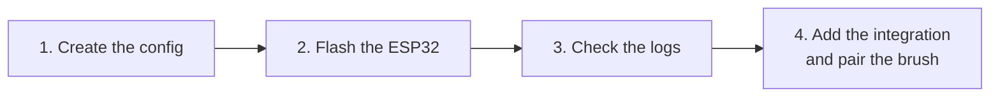
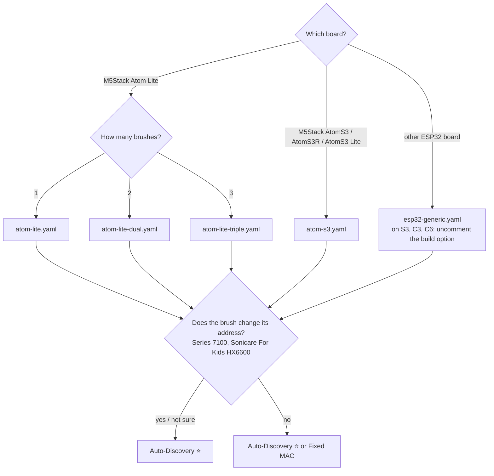

# ESP32 BLE Bridge Setup Guide

This guide explains how to set up an ESP32 as a Bluetooth Low Energy (BLE) bridge
for the Philips Sonicare Home Assistant integration. The ESP32 connects to the
toothbrush via BLE and relays data to Home Assistant over WiFi, removing the need
for direct Bluetooth access from the HA host.

> [!NOTE]
> This is a dedicated ESPHome component, not a standard [ESPHome Bluetooth Proxy](https://esphome.io/components/bluetooth_proxy.html). The differences are explained in [Bridge vs. bluetooth_proxy](README.md#bridge-vs-bluetooth_proxy).

The setup takes four steps:



## Contents

- [Tested Hardware](#tested-hardware)
- [Prerequisites](#prerequisites)
- [Setup overview](#setup-overview) — Auto-Discovery vs. Fixed MAC
- [Step 1: Create the ESPHome Configuration](#step-1-create-the-esphome-configuration)
  - [Required changes](#required-changes)
  - [What you should NOT change](#what-you-should-not-change)
  - [Minimal config snippets](#minimal-config-snippets)
- [Step 2: Flash the ESP32](#step-2-flash-the-esp32)
- [Step 3: Verify the Bridge Boots](#step-3-verify-the-bridge-boots)
- [Step 4: Add the Integration in Home Assistant](#step-4-add-the-integration-in-home-assistant)
  - [Expected pair-mode logs](#expected-pair-mode-logs)
- [Multi-Device Setup](#multi-device-setup)
- [Troubleshooting](#troubleshooting)
  - [ESP32 crashes/reboots when connecting](#esp32-crashesreboots-when-connecting)
  - [Pair-mode times out without finding the brush](#pair-mode-times-out-without-finding-the-brush)
  - ["No philips_sonicare services found"](#no-philips_sonicare-services-found)
  - ["No ESPHome devices found" in HA config flow](#no-esphome-devices-found-in-ha-config-flow)
  - [OTA install aborts with "WebSocket connection closed"](#ota-install-aborts-with-websocket-connection-closed)
  - [No data after OTA update](#no-data-after-ota-update)
- [Service & event reference](#service--event-reference)
- [Legacy: external `ble_client:`](#legacy-external-ble_client) — deprecated, for existing YAMLs only

## Tested Hardware

| Board | Tested | Build option¹ | Status |
| :--- | :---: | :---: | :--- |
| [M5Stack Atom Lite](https://docs.m5stack.com/en/core/ATOM%20Lite) (ESP32-PICO) | :white_check_mark: | — | Maintainer (up to 3 brushes); Community ([#13](https://github.com/mtheli/philips_sonicare_ble/issues/13), [#27](https://github.com/mtheli/philips_sonicare_ble/issues/27) — HX742X with rotating address) |
| [M5Stack AtomS3R](https://docs.m5stack.com/en/core/AtomS3R) (ESP32-S3) | :white_check_mark: | needed | Maintainer — HX742X with rotating address |
| [M5Stack AtomS3](https://docs.m5stack.com/en/core/AtomS3) (ESP32-S3) | :white_check_mark: | needed | Community ([#15](https://github.com/mtheli/philips_sonicare_ble/issues/15)) |
| [LilyGO T-Dongle-S3](https://lilygo.cc/products/t-dongle-s3) (ESP32-S3) | :white_check_mark: | needed | Community — HX742X with rotating address ([#38](https://github.com/mtheli/philips_sonicare_ble/issues/38)) |
| SB Components Micro-S3 (ESP32-S3) | :white_check_mark: | needed | Community — two HX742X with rotating address on one bridge ([#38](https://github.com/mtheli/philips_sonicare_ble/issues/38)) |
| [LCDwiki ES3C35P](https://www.lcdwiki.com/3.5inch_ESP32-S3_Display) / Freenove FNK0104N (ESP32-S3, 3.5" display) | :white_check_mark: | needed | Community — HX960V, `esp32-s3-devkitc-1` ([#47](https://github.com/mtheli/philips_sonicare_ble/issues/47)) |
| Generic ESP32 dev board (ESP32-WROOM/PICO) | :white_check_mark: | — | Community — two brushes on one bridge ([#15](https://github.com/mtheli/philips_sonicare_ble/issues/15)); DOIT ESP32 DevKit v1, `esp32doit-devkit-v1` ([#24](https://github.com/mtheli/philips_sonicare_ble/issues/24)); `esp32dev` ([#1](https://github.com/mtheli/philips_sonicare_ble/issues/1)); AZDelivery ESP32 NodeMCU ([#32](https://github.com/mtheli/philips_sonicare_ble/issues/32)); ESP32-WROOM-32 and a classic dev board, both with brushes that rotate their address ([#38](https://github.com/mtheli/philips_sonicare_ble/issues/38)) |
| Heemol ESP32 Mini (classic ESP32, mini form factor) | :white_check_mark: | — | Community ([#20](https://github.com/mtheli/philips_sonicare_ble/issues/20)) |
| ESP32-S3 DevKitC-1 | :grey_question: | needed | Should work — same SoC as the confirmed S3 boards. Untested — on an ESP32-S3-N16R8 two HX6600 paired but did not reconnect without it ([#38](https://github.com/mtheli/philips_sonicare_ble/issues/38)) |
| ESP32-C3 / ESP32-C6 | :grey_question: | needed | Untested — on an ESP32-C3 SuperMini a HX742X paired but did not reconnect without it ([#38](https://github.com/mtheli/philips_sonicare_ble/issues/38)) |

¹ `-DCONFIG_BT_BLE_RPA_SUPPORTED=0` under `esphome: build_flags`, see [Required changes](#required-changes), item 4. Every chip but the original ESP32 needs it for brushes with a rotating address (Series 7100, Sonicare For Kids HX6600), see the [known issue](KNOWN_ISSUES.md#brushes-with-a-rotating-address-stop-reconnecting-on-newer-esp32-chips). Brushes with a fixed address work without it.

## Prerequisites

- **ESPHome 2026.7.1 or newer**, as the Home Assistant add-on (ESPHome Device Builder) or standalone. New to ESPHome? Start with [Getting Started with ESPHome and Home Assistant](https://esphome.io/guides/getting_started_hassio/). Older versions cannot build the example configs, and running `bluetooth_proxy:` on the same ESP crashes them, see [ESP32 crashes/reboots when connecting](#esp32-crashesreboots-when-connecting).
- **ESP32 board** — see [Tested Hardware](#tested-hardware) above
- **Philips Sonicare toothbrush** — see [Tested Models](../README.md#tested-models)

## Setup overview

There are two ways to tell the bridge which brush it belongs to:

- **Auto-Discovery** ⭐ (recommended, works with every brush) — no MAC address in the YAML. You pair the brush through the Home Assistant setup dialog.
- **Fixed MAC** — you write the brush's MAC address into the YAML and the bridge connects to it on its own. Only for brushes whose address never changes. The Series 7100 (HX742X) and Sonicare For Kids HX6600 change their address, so do not use Fixed MAC for them.

The walkthrough below uses Auto-Discovery, with the Fixed MAC variant called out where the steps differ.

Which example config and which path fit your setup:



## Step 1: Create the ESPHome Configuration

Start from one of the example configs in [`examples/`](examples/). For example:

- [`atom-lite.yaml`](examples/atom-lite.yaml) — M5Stack Atom Lite, one brush
- [`atom-s3.yaml`](examples/atom-s3.yaml) — M5Stack AtomS3 / AtomS3R / AtomS3 Lite (ESP32-S3)
- [`esp32-generic.yaml`](examples/esp32-generic.yaml) — any classic ESP32 dev board

All examples, including configs for two and three brushes, are listed in the [README](README.md#contents).

To get it into the ESPHome dashboard:

1. In the ESPHome dashboard, click **+ New Device**, give it a name and pick your board type. When it offers to install, choose **Skip**.
2. The dashboard has created a config with a fresh API encryption key. Click **Edit** on the new device and copy that key (the value under `api: encryption: key:`), you need it for `secrets.yaml` below.
3. Replace the whole content with the example config, set `name:` to the name you chose, then make the changes below and click **Save**.

The examples load the component with `ref: master`, which is fine to start with. To stay on a fixed release instead, see [Version pinning](README.md#version-pinning).

If you already have an ESP32 running other components (e.g. `ble_adv_proxy`,
`bluetooth_proxy`), you can add the Sonicare component to your existing config
instead of using the template.

### Required changes

1. **Board type** — each example targets one board. Change it if yours differs:
   ```yaml
   esp32:
     board: m5stack-atom   # or m5stack-atoms3, esp32dev, esp32-s3-devkitc-1, …
   ```

2. **Secrets** — the examples read passwords from `secrets.yaml`. In the ESPHome dashboard, open it with **Secrets** (top right) and add:
   ```yaml
   api_encryption_key: "<the key you copied from the new device>"
   ota_password: "<choose a password for wireless updates>"
   wifi_ssid: "<your Wi-Fi name>"
   wifi_password: "<your Wi-Fi password>"
   fallback_password: "<choose a password>"
   ```
   `fallback_password` protects the hotspot the ESP opens when it cannot reach your Wi-Fi. If you did not copy a key, the [ESPHome API page](https://esphome.io/components/api/) can generate one.

3. **ESP-IDF 5.5.5 with ESPHome 2026.10** — its default ESP-IDF 5.5.6 makes the bridge lose pairings after the first disconnect. The examples already pin it; in your own config add:
   ```yaml
   esp32:
     framework:
       type: esp-idf
       version: 5.5.5
   ```
   ESPHome warns that this is not the recommended version; that is expected. See the [known issue](KNOWN_ISSUES.md#esp-bridge-loses-pairings-with-esp-idf-556).

4. **Build option on ESP32-S3, C3, C6 and other newer chips** — needed for brushes with a rotating address (Series 7100, Sonicare For Kids HX6600). Without it the bridge pairs, but loses the brush after the first session. [`atom-s3.yaml`](examples/atom-s3.yaml) already has it; otherwise add:
   ```yaml
   esphome:
     build_flags:
       - -DCONFIG_BT_BLE_RPA_SUPPORTED=0
   ```
   Not needed on the original ESP32. See the [known issue](KNOWN_ISSUES.md#brushes-with-a-rotating-address-stop-reconnecting-on-newer-esp32-chips).

### What you should NOT change

- **Framework** `esp-idf` — the Arduino framework cannot raise the Bluetooth limits the bridge needs.
- **`sdkconfig_options`** `CONFIG_BT_GATTC_MAX_CACHE_CHAR` and `CONFIG_BT_GATTC_NOTIF_REG_MAX`, and `max_notifications` under `esp32_ble:` — without them some sensors silently stop updating. Background: [Notification subscription limit](KNOWN_ISSUES.md#notification-subscription-limit-default-too-low).
- **API flags** `custom_services: true` and `homeassistant_services: true` — the bridge needs them to register its services.
- **`external_components`** — loads the component from this repository. With `ref: master`, `refresh: 0s` fetches the latest code on every build; to stay on a release, set `ref:` to its tag (see [Version pinning](README.md#version-pinning)).

### Minimal config snippets

If you're adding the bridge to an existing ESPHome config, these are the blocks you need. The shared infrastructure is the same for both paths; only the `philips_sonicare:` entry differs.

#### Shared infrastructure

```yaml
esphome:
  # Uncomment on ESP32-S3, C3, C6 and other newer chips, see Required changes, item 4
  # build_flags:
  #   - -DCONFIG_BT_BLE_RPA_SUPPORTED=0

esp32:
  framework:
    type: esp-idf
    version: 5.5.5   # see Required changes, item 3
    sdkconfig_options:
      CONFIG_BT_GATTC_MAX_CACHE_CHAR: "80"
      CONFIG_BT_GATTC_NOTIF_REG_MAX: "20"

api:
  custom_services: true
  homeassistant_services: true

esp32_ble:
  io_capability: none
  max_notifications: 20

esp32_ble_tracker:
  scan_parameters:
    active: true

external_components:
  - source:
      type: git
      url: https://github.com/mtheli/philips_sonicare_ble
      ref: master   # or a release tag, see Version pinning in the README
      path: esphome/components
    components: [philips_sonicare]
    refresh: 0s
```

#### Auto-Discovery (preferred)

No MAC in YAML — the brush is paired through the HA setup dialog and the
identity is persisted to NVS:

```yaml
philips_sonicare:
  - id: philips_sonicare_ble
    connected:
      name: "Sonicare Connected"
    on_connect:
      then:
        - logger.log: "Connected to Sonicare"
    on_disconnect:
      then:
        - logger.log: "Disconnected from Sonicare"
```

#### Fixed MAC

<details>
<summary>Only for brushes with a fixed address — click to expand</summary>

Set `mac_address:` to pin the bridge to a specific brush. The bridge connects
on boot without going through the HA pair-dialog:

```yaml
philips_sonicare:
  - id: philips_sonicare_ble
    mac_address: "XX:XX:XX:XX:XX:XX"   # <-- your toothbrush's MAC
    connected:
      name: "Sonicare Connected"
    on_connect:
      then:
        - logger.log: "Connected to Sonicare"
    on_disconnect:
      then:
        - logger.log: "Disconnected from Sonicare"
```

To find the MAC, the brush advertises as "Philips Sonicare" for ~20 seconds
after being picked up from the charger or turned on/off:

- **Home Assistant Bluetooth**: Settings → Devices & Services → Bluetooth →
  look for "Philips Sonicare"
- **nRF Connect** ([Android](https://play.google.com/store/apps/details?id=no.nordicsemi.android.mcp) / [iOS](https://apps.apple.com/app/nrf-connect-for-mobile/id1054362403)):
  scan and filter for "Philips"
- **ESPHome logs**: any ESP32 with `esp32_ble_tracker` enabled will print
  `Found device … Name: 'Philips Sonicare'`

</details>

## Step 2: Flash the ESP32

1. In the ESPHome dashboard, click **Install** on the device.
2. **First flash:** connect the ESP32 by USB and choose **Plug into this computer** (needs Chrome or Edge) or **Plug into the computer running ESPHome Device Builder** (USB on the Home Assistant machine).
3. **Later updates:** choose **Wirelessly**.
4. Wait until the build and flash are done. The first build takes several minutes.

> [!NOTE]
> Switching between Arduino and ESP-IDF framework requires a full clean build
> ("Clean Build Files" in the ESPHome dashboard before flashing).

> [!TIP]
> Once set up, the integration adds a **Bridge Firmware** update entity (on the
> Connection sub-device) that notifies you when a newer bridge firmware is
> available, with cumulative release notes. It's informational only — reflash
> via the ESPHome dashboard as above; there's no install button.

## Step 3: Verify the Bridge Boots

After flashing, the ESP32 boots and starts scanning. To watch it, click **Logs** on the device in the ESPHome dashboard. The expected boot log depends on which configuration path you chose.

**Auto-Discovery (no MAC, no stored bond)** — the bridge does **not** initiate
any connection on its own; it waits for the HA setup flow to arm pair-mode:

```
[I][philips_sonicare:065]: Services registered
[I][philips_sonicare:072]: No identity in flash — UUID scan mode (waiting for pair-mode)
[C][philips_sonicare:110]: Philips Sonicare Bridge vX.Y.Z
```

The `No identity in flash — UUID scan mode` line confirms the bridge is up and
waiting for pair-mode. In multi-bridge setups, the log tag becomes
`philips_sonicare.<bridge_id>` (e.g. `philips_sonicare.kids`,
`philips_sonicare.prestige`) so each bridge's lines are identifiable in the
stream and `logger:` filters can target a single bridge by suffix.

**Fixed MAC** — the bridge logs the configured MAC and starts connecting
immediately:

```
[I][philips_sonicare:065]: Services registered
[I][philips_sonicare:063]: Using configured MAC address — MAC mode
[C][philips_sonicare:110]: Philips Sonicare Bridge vX.Y.Z
```

After a successful pair, subsequent boots show the brush reconnecting on its own:

```
[D][esp32_ble_client:207]: [1] [24:E5:AA:xx:xx:xx] Found device
[I][esp32_ble_client:125]: [1] [24:E5:AA:xx:xx:xx] 0x00 Connecting
[I][esp32_ble_client:570]: [1] [24:E5:AA:xx:xx:xx] auth complete addr: …
[I][philips_sonicare:670]: Pairing successful — device bonded (auth_mode=…)
[I][philips_sonicare:363]: Service discovery complete
```

> [!NOTE]
> Some models (DiamondClean Smart HX992X, Sonicare For Kids HX63xx) connect without pairing, so no `auth success` line appears. Models that pair (Prestige HX999X, ExpertClean HX962X, HX991M, Series 7100 HX742X, Sonicare For Kids HX6600) log `auth success` after a successful pair-mode run.

## Step 4: Add the Integration in Home Assistant

1. Install the **Philips Sonicare** integration in Home Assistant
   (via [HACS](../README.md#installation) or manually)
2. Go to **Settings > Devices & Services > + Add Integration** and search for **Philips Sonicare**
3. Select **"ESP32 Bridge (ESPHome)"** → pick your ESP32 from the list
4. If the ESP exposes multiple bridge slots (multi-device setup), pick the one
   you want to bond

> [!TIP]
> Want to see the dialogs before you start? The [interactive config-flow walkthrough](https://mtheli.github.io/philips_sonicare_ble/config_flow_walkthrough.html) lets you click through every setup screen with example data.

What happens next depends on the configuration path:

**Auto-Discovery** — the slot is empty (`pair_capable=true`), so the
integration goes straight to **"Pair toothbrush with bridge"**:

1. Switch on the brush you want to bond (press the power button)
2. Hold it within ~1 m of the ESP
3. Click **Start pairing** — the bridge scans for ~60 s and bonds with the
   first Sonicare it finds

> [!IMPORTANT]
> If you have multiple toothbrushes nearby, only switch on the one you want to
> bond — the bridge bonds to the first matching brush, period. The pair dialog
> in HA reminds you of this.

**Fixed MAC** — there is no pair dialog. Switch on the brush, keep it within range (not on the charger), then continue.

After both paths, the integration shows the **Connection via ESP32 Bridge** page (bridge version, BLE connection, pairing status, MAC). Click **Read capabilities** to finish setup.

### Expected pair-mode logs

A successful pair-mode run on the ESP looks like this:

```
[I][philips_sonicare:146]: Pair-mode enabled for 60s
[I][philips_sonicare:213]: Found Sonicare via UUID at AA:BB:CC:DD:EE:FF (pair-mode, classic)
[I][esp32_ble_client:125]: [1] [AA:BB:CC:DD:EE:FF] 0x00 Connecting
[I][esp32_ble_client:343]: [1] [AA:BB:CC:DD:EE:FF] Connection open
[I][philips_sonicare:301]: Connected to Sonicare (AA:BB:CC:DD:EE:FF)
[I][esp32_ble_client:570]: [1] [AA:BB:CC:DD:EE:FF] auth complete addr: AA:BB:CC:DD:EE:FF
[D][esp32_ble_client:575]: [1] [AA:BB:CC:DD:EE:FF] auth success type = 0 mode = 9
[I][philips_sonicare:253]: Bonded — saving identity AA:BB:CC:DD:EE:FF, switching to MAC mode
[I][philips_sonicare:670]: Pairing successful — device bonded (auth_mode=9)
```

The `(pair-mode, classic)` token identifies the brush family — `classic` for
the per-feature service-based protocol (HX9XXX etc.), `condor` for the
HX742X / Series 7100 framed transport. After `Bonded — saving identity`
the bridge writes the bond to NVS and the brush will reconnect on its own
across reboots (no further pair-mode needed).

> [!NOTE]
> Models with **open GATT** (DiamondClean Smart HX992X) skip the SMP / auth
> dance — you'll see `Connected to Sonicare …` and `Service discovery complete`
> but no `auth success` line. Bond persistence still works via the saved
> identity, so reconnect on next boot is the same.

## Multi-Device Setup

A single ESP32 can bridge **multiple** Sonicare toothbrushes. Each gets its
own `philips_sonicare:` entry with a unique `bridge_id`. Each slot can use
either path independently — Auto-Discovery, Fixed MAC, or a mix:

```yaml
philips_sonicare:
  - id: sonicare_prestige
    bridge_id: prestige
    friendly_name: "Master Bath"        # pre-fills HA setup name
    area: "Master Bathroom"             # auto-assigns HA area on install
    # Auto-Discovery — paired via HA dialog

  - id: sonicare_kids
    bridge_id: kids
    friendly_name: "Kids"
    area: "Kids Bathroom"
    mac_address: "XX:XX:XX:XX:XX:XX"   # Fixed MAC — pinned from YAML
```

The `bridge_id` is **required** when using multiple instances — the ESP will
refuse to compile without it. It serves as a suffix for service names
(e.g., `ble_pair_mode_prestige`, `ble_read_char_prestige`) so HA can address
each slot separately. The same label appears in the HA bridge picker (unless
`friendly_name` is set, in which case that wins).

`friendly_name` and `area` are optional one-shot setup defaults: they
pre-fill the HA name prompt and area picker the first time the brush is
added. Edits after install don't propagate — rename via HA's device-rename
UI after that.

Each slot has its own bond storage in NVS, so the two brushes are completely
independent — pair, unpair, or re-pair one without affecting the other.

### Pairing brushes one at a time

Slots exist from the moment they are compiled in, but an Auto-Discovery slot
stays passive until Home Assistant arms it — it only connects while its own
pair-mode is running, and pair-mode is armed per slot
(`ble_pair_mode_<bridge_id>`). So declare every slot you need up front, flash
**once**, and pair the brushes one after another. The slots still waiting their
turn ignore every advertisement in the meantime.

1. Add one `philips_sonicare:` entry per brush, each with a unique `id` and
   `bridge_id` and no `mac_address:`. Size `sdkconfig_options` for the final
   brush count right away — see [`atom-lite-triple.yaml`](examples/atom-lite-triple.yaml).
   Running out of notification slots produces no build error, only sensors that
   never update.
2. Flash, then run the [ESP32 Bridge setup
   flow](#step-4-add-the-integration-in-home-assistant) once per slot, picking
   the slot by its `friendly_name` — or by its `bridge_id` if none is set.
3. Wake only the toothbrush meant for that slot and start pairing. Leave the
   brushes already on the bridge paired: every slot keeps its own identity in
   NVS, and since bridge **v1.12.0** a slot refuses a brush that another slot
   already owns.

A brush that turns up later does need another flash, since its slot has to
exist in the YAML first. Leave the paired entries untouched, add the new one,
and repeat from step 2.

Auto-Discovery matters most on the Series 7100 / HX742X. Those advertise with a
rotating address before bonding, so an address copied from a scan can already
be stale by the time the bridge connects. Pairing an empty slot stores the
brush's stable identity in NVS and the bridge follows the rotation from then
on. Don't set `mac_address:` for these models unless you know the address is
that stable identity — the pairing log names it:

```
[I][philips_sonicare.kids:354]: Bonded — saving identity 6C:62:0E:0B:33:D1, switching to MAC mode
```

Full examples:
- [`examples/atom-lite-dual.yaml`](examples/atom-lite-dual.yaml) — 2 brushes
- [`examples/atom-lite-triple.yaml`](examples/atom-lite-triple.yaml) — 3 brushes (Atom Lite limit)

> [!IMPORTANT]
> **RAM limit on single-core ESP32 boards.** The M5Stack Atom Lite
> (ESP32-PICO-D4, 320 KB SRAM) handles **2 brushes comfortably and 3
> brushes at the limit**. With 4 brushes the bridge runs out of heap
> during normal operation. The bridge logs a periodic warning as the
> heap approaches the safety threshold, and refuses new connections
> rather than crashing:
>
> ```
> [W][philips_sonicare.heap]: Heap low: free=14816 min_ever=6248 largest_block=12800
> [W][philips_sonicare.<id>:204]: Refusing new connection attempt: free heap 15896 below safety threshold 25000
> ```
>
> For 4+ brushes, pick one of:
> - **Two Atom Lite bridges, ~2 brushes each** — HA sees them as
>   independent ESPHome devices, no integration changes needed. Cheapest
>   path if you already have hardware.
> - **An ESP32-S3 board** (e.g. [M5Stack AtomS3R](https://docs.m5stack.com/en/core/AtomS3R)
>   or ESP32-S3-DevKitC-1) — dual-core, more SRAM, enough headroom for
>   4 brushes on a single bridge.
>
> ESP32-C3 / ESP32-C6 are not recommended for multi-brush setups (single
> core + less SRAM than Atom Lite).

> [!NOTE]
> Each toothbrush should only be connected via **one** path — either Direct BLE
> or ESP Bridge, not both simultaneously.

---

## Troubleshooting

Known problems with ESPHome, ESP-IDF and particular chips, with workarounds, are listed in the [ESP bridge known issues](KNOWN_ISSUES.md).

Click a problem to expand it.

<a id="esp32-crashesreboots-when-connecting"></a>
<details>
<summary><b>ESP32 crashes/reboots when connecting</b></summary>

> On builds from ESPHome < 2026.7.1 with `bluetooth_proxy:` enabled, the ESP32
> crashes in the Bluedroid GATT cache during service discovery with
> `Fault - LoadProhibited / bta_gattc_cache_save`. Since bridge firmware v1.10.0
> the component refuses to build that crash-prone combination and prints the
> options below instead.
>
> **Fix:** update to ESPHome 2026.7.1 or newer (it bundles ESP-IDF 5.5.5, which
> carries the upstream fix) and rebuild. If you have to stay on an older ESPHome,
> set `bluetooth_proxy: cache_services: false`, apply the
> [Bluedroid NULL-check patch](README.md#bluedroid-null-check-patch-bluedroid_null_fixpy),
> or disable `bluetooth_proxy`.

</details>

<a id="pair-mode-times-out-without-finding-the-brush"></a>
<details>
<summary><b>Pair-mode times out without finding the brush</b></summary>

> Two distinct causes, and the ESP log tells them apart.
>
> **Cause 1 — the scanner ran passively (only with `bluetooth_proxy:` on the
> same ESP).** Sonicare handles send the service UUID that pair-mode matches on
> only in the scan response, which a passive scan never requests — the bridge
> cannot see the brush at all, however close and awake it is. When
> `bluetooth_proxy:` is compiled in, Home Assistant owns the shared scanner and
> its per-device scanning mode (default **Auto** since HA 2026.6, which scans
> passively) overrides the `esp32_ble_tracker` `scan_parameters` at runtime.
> Firmware v1.11.0 names this case when the window closes:
>
> ```
> [W][philips_sonicare:311]: Pair-mode ran its whole window with the BLE scanner PASSIVE — the toothbrush could not be discovered. …
> ```
>
> **Fix:** pairing from the integration's setup dialog handles this on its own
> from v0.24.0 — it requests active scan windows for the whole pair window, and
> if none could be had, the timeout dialog says so. If you see the warning
> anyway (older integration, scanning mode pinned to *Passive*, or pair-mode
> armed manually via **Developer tools > Actions**), set the ESP's Bluetooth
> scanning mode to **Active** under **Settings > Devices & Services > ESPHome >
> Configure** and try again. Without `bluetooth_proxy:` in the YAML this cause
> is off the table — `scan_parameters.active: true` applies unconditionally.
>
> **Cause 2 — timing.** No warning in the log, the scanner was active, the
> brush just never advertised into the window: it only advertises for
> ~20 seconds after waking up.
>
> **Fix:** work through these, in order:
>
> - Press the power button or pick the brush up from the charger immediately
>   before clicking **Start pairing**, then keep it on
> - Remember the brush is **not reachable** via BLE while on the charging stand
> - Make sure no phone has an active connection to the brush — close or uninstall
>   the Sonicare app
> - Keep the brush within ~1 m of the ESP during pair-mode

</details>

<a id="no-philips_sonicare-services-found"></a>
<details>
<summary><b>"No philips_sonicare services found"</b></summary>

> **Fix:** add `custom_services: true` and `homeassistant_services: true` under
> the `api:` section of your ESPHome config. Both flags are required since
> ESPHome 2025.7.0.

</details>

<a id="no-esphome-devices-found-in-ha-config-flow"></a>
<details>
<summary><b>"No ESPHome devices found" in HA config flow</b></summary>

> The ESP32 must be fully set up and connected to Home Assistant via the ESPHome
> integration before the config flow can offer it.
>
> **Fix:**
>
> - Check **Settings > Devices & Services > ESPHome** — your device should be
>   listed there
> - On a fresh ESPHome install, wait for the device to come online after flashing

</details>

<a id="ota-install-aborts-with-websocket-connection-closed"></a>
<details>
<summary><b>OTA install aborts with "WebSocket connection closed"</b></summary>

> The build log stops mid-compile (e.g. `[1473/1521] Building CXX object ...`) and
> the dashboard afterwards reports the device as out of sync, still on its
> previously deployed version. Nothing was flashed — the ESP keeps running its old
> binary, so this is safe to retry.
>
> It is most common on the first install after the ESPHome builder itself was
> updated: crossing a builder version forces a near-complete recompile (~1500
> compile units) instead of the usual handful, and the dashboard's log stream is
> an Ingress WebSocket that can be dropped during those minutes of sustained CPU
> and RAM use. A sleeping browser tab or a reverse-proxy timeout produces the same
> symptom.
>
> **Fix:** click **Install** again. The object cache survives, so the retry only
> compiles what was left and completes quickly.

</details>

<a id="no-data-after-ota-update"></a>
<details>
<summary><b>No data after OTA update</b></summary>

> After an OTA flash, the ESP32 reboots and reconnects to the toothbrush via BLE
> before Home Assistant re-establishes the API stream (~5-10 seconds). The bridge
> automatically re-fires the "ready" event every 15 seconds until HA subscribes to
> notifications.
>
> **Fix:** if data still doesn't flow after that:
>
> - **Reload the integration** in HA (Settings > Devices & Services >
>   Philips Sonicare > ... > Reload)
> - Check ESPHome logs for `BLE connected, no subscriptions — re-firing ready`
> - Check HA logs for `ESP bridge rebooted — forcing re-setup`

</details>

---

## Service & event reference

The bridge exposes its functionality to Home Assistant as a small set of
ESPHome services (`ble_read_char`, `ble_subscribe`, `ble_pair_mode`, …) and
fires events back (`esphome.philips_sonicare_ble_data`,
`esphome.philips_sonicare_ble_status`, `esphome.philips_sonicare_ble_services`).
For the architecture diagram, the full per-service signatures, and the event
field reference, see **[PROTOCOL.md](PROTOCOL.md)**.

---

## Legacy: external `ble_client:`

<details>
<summary><strong>Show the legacy configuration</strong> (kept for backwards compatibility)</summary>

Earlier versions of this component required an external `ble_client:` block
that the `philips_sonicare:` entry then referenced via `ble_client_id:`. This
configuration is still accepted so existing YAMLs keep working, but it offers
no advantage over [Fixed MAC](#fixed-mac) above — both pin the brush by MAC
and connect on boot — while requiring an extra block. **New setups should use
Auto-Discovery or Fixed MAC.**

```yaml
ble_client:
  - mac_address: "XX:XX:XX:XX:XX:XX"   # <-- your toothbrush's MAC
    id: my_brush
    auto_connect: true

philips_sonicare:
  - ble_client_id: my_brush
    connected:
      name: "Sonicare Connected"
```

To migrate to Fixed MAC, drop the `ble_client:` block, replace
`ble_client_id: my_brush` with `mac_address: "XX:XX:XX:XX:XX:XX"`, and
re-flash. The bond persists across the migration since it lives on the
ESP's NVS, not in the YAML.

> [!NOTE]
> The `on_connect` / `on_disconnect` automations on the external `ble_client:`
> fire on raw GAP-connect, before service discovery completes. Use the
> equivalent triggers on the `philips_sonicare:` entry instead — they fire
> after the bridge is `ready`, when reads and writes are actually safe.

</details>
